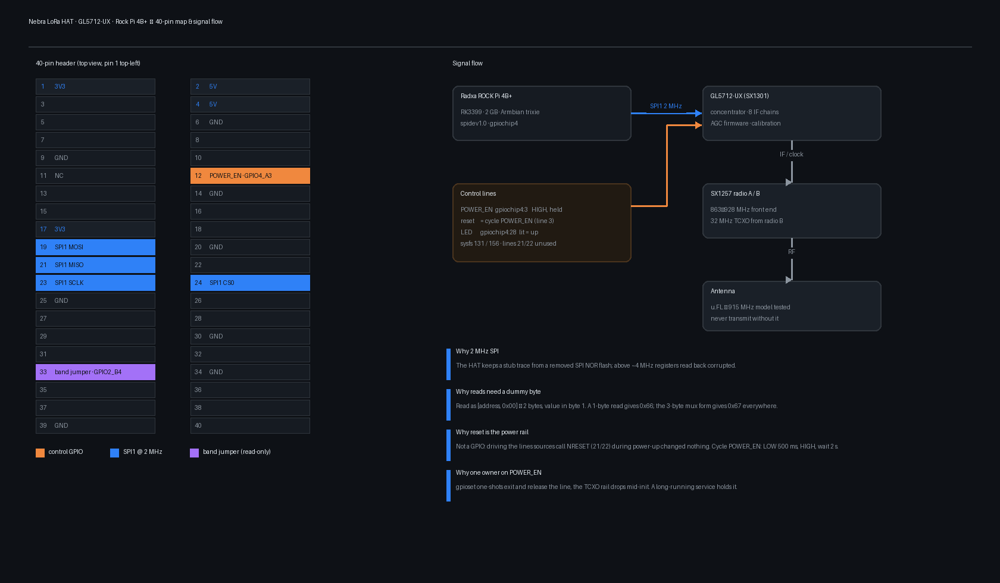

# Armbian with Nebra LoRa HAT - GL5712-UX

The Nebra Indoor hotspot (Rock Pi version) is a Rock Pi 4B+ with a LoRa HAT on the
40-pin header. The HAT carries a **MAXIIOT GL5712-UX**: an SX1301 concentrator with
two SX1257 radios, **902–928 MHz**.

Driving it from plain Armbian is where most attempts stop — every register reads
`0x66` and the module looks dead. This is the bring-up that works: the exact
sequence, the numbers it prints, and the traps that cost days, so a bare board
becomes a calibrated, receiving radio in an evening.

```
Board      Radxa ROCK Pi 4B+ · RK3399 · 2GB · 32GB
HAT        Nebra LoRa · GL5712-UX · SX1301 + 2× SX1257 · 902–928 MHz (tested)
OS         Armbian 26.11.1 (trixie) · kernel 6.18.44-current-rockchip64
DTB        rockchip/rk3399-rock-pi-4b-plus.dtb
Bus        /dev/spidev1.0 · 2 MHz · mode 0
GPIO       gpiochip4 → POWER_EN 3 (held; cycling it resets the chip) · LED 28
```

## What was proven on this **[hardware](docs/hardware.md#the-two-boards)**

```
SPI          test_loragw_reg : 5 register checks, both numbers equal, exit 0
Calibration  test_loragw_cal : Rx A 143 (0x8F), Rx B 151 (0x97), no WARNING,
                               image rejection 50-63 dB
Start        lgw_start       : status 191 (0xBF) - RX and TX calibration
Receive      test_loragw_hal : 13 frames in 60 s, RSSI +52 dBm, counter
                               increments per frame (its own TX looped back)
```

## Wiring and signal flow



## Before you start

Every step below ends with a **pass condition**. If you do not see it, stop there and
open one of those pages — the next step will otherwise fail in a way that looks like
new hardware trouble.

Two pages are worth five minutes:

- **[failed](docs/failed.md)** — the five traps that break this board before the
  radio is ever at fault (the rail is the reset, register reads need a dummy byte,
  SPI wants 2 MHz, POWER_EN must be held, a warm reboot can latch the chip).
- **[troubleshooting](docs/troubleshooting.md)** — every failure seen during
  bring-up, by symptom.

## 0. [Armbian](docs/armbian.md) Installation

```bash
sudo apt update && sudo apt install -y git
git clone https://github.com/fachos/armbian-nebra-lora-hat-gl5712-ux.git gl5712-ux
```

Commands below assume you are in the directory that holds `gl5712-ux/` — your home
directory after that clone. Next come the build tools and the two Python modules.
A single unknown package name aborts the whole `apt install`, so the list is checked
before anything is installed:

```bash
sudo bash gl5712-ux/scripts/packages.sh
```

**Pass condition** — the last two lines:

```
  ok       import spidev
  ok       from gpiod.line import Direction, Value
```

## 1. Enable SPI → `/dev/spidev1.0`

```bash
sudo bash gl5712-ux/scripts/armbian-spi.sh && sudo reboot
```

The script prints the four `armbianEnv.txt` lines it wrote.

**Pass condition** — after the reboot:

```bash
ls -l /dev/spidev1.0          # the node exists
```

## 2. Fix [POWER_EN](docs/power-gpio.md), own the status LED

```bash
sudo install -d /usr/local/share/nebra
sudo install -m 0755 gl5712-ux/scripts/nebra_hat.py /usr/local/sbin/nebra-hat
sudo install -m 0644 gl5712-ux/scripts/sx_probe.py  /usr/local/share/nebra/sx_probe.py
sudo install -m 0644 gl5712-ux/scripts/nebra-lora-power.service /etc/systemd/system/
sudo systemctl daemon-reload
sudo systemctl enable --now nebra-lora-power
```

**Pass condition** — the unit is active and has already cycled the rail and probed:

```bash
systemctl is-active nebra-lora-power            # active
journalctl -u nebra-lora-power -n 20 --no-pager
#   nebra-hat[812]: reset: POWER_EN line 3 LOW 0.5s
#   nebra-hat[812]: reset: POWER_EN HIGH, settling 2.0s, LED line 28 on
#   nebra-hat[812]: probe: /dev/spidev1.0: 00=00 01=67 02=00 03=00
#   nebra-hat[812]: probe: /dev/spidev1.0: SX1301 ALIVE (VERSION=0x67 at reg 0x01)
```

Green LED on. If the LED is dark, the service is not holding the line.

## 3. Get the chip answer

```bash
sudo python3 gl5712-ux/scripts/sx_probe.py
```

**Pass condition** —

```
/dev/spidev1.0: 00=00 01=67 02=00 03=00
/dev/spidev1.0: SX1301 ALIVE (VERSION=0x67 at reg 0x01)
```

The same value on every register (`0x66`, or `0x67` everywhere) means nothing is
driving MISO: unpowered, still in reset, or the bus is too fast.

## 4. Build the [HAL](docs/hal.md), test the registers, calibrate

If the first register test after a boot fails, re-bind the spidev driver and run the
script again — the binding has to be manual, the script does not touch it:

```bash
sudo sh -c 'echo spi1.0 > /sys/bus/spi/drivers/spidev/unbind; sleep 1; echo spi1.0 > /sys/bus/spi/drivers/spidev/bind'
```

The script does five things and checks each one: fetch/reset the HAL source, set the SPI
device and speed for this HAT, build, run the register test, run the calibration.

```bash
sudo bash gl5712-ux/scripts/build-hal.sh /opt/lora_gateway
# any pair inside 902-928 MHz works, not just 915/916 — e.g. AS923-1:
# sudo bash gl5712-ux/scripts/build-hal.sh /opt/lora_gateway -a 923.1 -b 923.4
```

**Pass condition 1/3 — register test.** Both numbers equal on all five lines, then:

```
IMPLICIT_PAYLOAD_LENGHT = 197 (should be 197)
FRAME_SYNCH_PEAK2_POS = 11 (should be 11)
PREAMBLE_SYMB1_NB = 49253 (should be 49253)
ADJUST_MODEM_START_OFFSET_SF12_RDX4 = 3173 (should be 3173)
IF_FREQ_1 = -1947 (should be -1947)
End of test for loragw_reg.c
```

**Pass condition 2/3 — calibration.** One line per iteration, per radio:

```
  Rx A: 5/5 iterations at status 0x8F, image rejection >= 50 dB
  Rx B: 5/5 iterations at status 0x97, image rejection >= 57 dB
```

**Pass condition 3/3 — the script's own verdict:**

```
Calibration OK — Rx A 143 (0x8F) and Rx B 151 (0x97), log: /tmp/nebra-test_loragw_cal.log
```

`143` and `151` are the per-radio calibration statuses, not an error: the test
calibrates one radio per command, so each status carries only that radio's bits.
`0x9F` (159) is the combined status `lgw_start` reports, and `191` (0xBF) is the
same with the TX DC-offset path included. Both mean healthy.

## 5. Prove the receive path

```bash
cd /opt/lora_gateway/libloragw
sudo timeout 60 ./test_loragw_hal -a 915.0 -b 916.0 -t 916.0 -r 1257 > /tmp/nebra-rx.log 2>&1
grep -c 'Rcv pkt' /tmp/nebra-rx.log        # 13 on a healthy board
```

`2>&1` matters: the HAL writes its `Note:` lines to `stderr`, so a plain `>` loses the
calibration status line. Exit code `124` is the timeout doing its job. All three
frequencies are mandatory — the argument check rejects a missing `-t` even though this
test only stores it. One process at a time: nothing else may hold `/dev/spidev1.0`.

**Pass condition** — the concentrator starts and then prints its own frames coming back:

```
lgw_start:844: Note: calibration finished (status = 191)
*** Concentrator started ***
+++
Sending packet #0, rf path 0, return 0
status -> 4:2:
TX finished
Rcv pkt #1 >> if_chain: 2 tstamp:0007583812 size: 20 LoRa SF9 CR1(4/5)
 RSSI: +52.0 SNR: +4.2 (min: +0.2, max: +6.8) payload:
 54 58 2E 54 45 53 54 2E 4C 4F 52 41 2E 47 57 2E 00 00 00 00 #
```

`status -> 4:2:` is the TX status word this build prints; the frames still return, so
`TX finished` followed by a `Rcv pkt` block is what to look for. This test is a closed
loop: every ~4.8 s it transmits `TX.TEST.LORA.GW.` plus a counter on radio A and
receives its own frame on IF chain 2 — 13 frames in 60 s on this board, RSSI around
+52 dBm. That is self-reception, not a node across the room. It proves TX scheduling,
the PA, the receive chain, demodulation and CRC; it does not prove antenna gain or
weak-signal sensitivity.

## Init sequence, for reference

```
1  POWER_EN  = HIGH         held for the life of the process (gpiochip4:3)
2  POWER_EN  = LOW   500ms  drop the rail — this is the reset
3  POWER_EN  = HIGH         raise it again; chip boots from POR
4  sleep 2s                 TCXO + MCU startup; skip it and SPI reads 0x66
5  open /dev/spidev1.0, 2 MHz, mode 0
6  read reg 0x01            expect 0x67  ← checkpoint, stop here if not
7  lgw_board_setconf        clksrc 1 (radio B supplies 32 MHz), TX notch 129 kHz
8  lgw_rxrf_setconf(A/B)    radio A on carrier, radio B parked off-carrier
9  lgw_rxif_setconf(8)      LoRa std channel: one bandwidth, one spreading factor
10 lgw_start                AGC firmware + calibration → combined status 0x9F
11 radio ready              receive loop, or your own application
```

## Read in order

- [docs/hardware.md](docs/hardware.md) — 40-pin map, LED behaviour
- [docs/failed.md](docs/failed.md) — the five traps that break this board
- [docs/troubleshooting.md](docs/troubleshooting.md) — every failure hit during bring-up
- [docs/armbian.md](docs/armbian.md) — fresh Armbian → `/dev/spidev1.0` (steps 0–1)
- [docs/power-gpio.md](docs/power-gpio.md) — POWER_EN / reset / LED service (step 2)
- [docs/hal.md](docs/hal.md) — HAL build, calibration, receive test (steps 3–5)

## References

Datasheets, vendor sources and community notes used here: **[REFERENCE.md](REFERENCE.md)**.

## Support

If this saved you time, you can put a little back — it goes into bench hardware and
more notes like these.

- **Ko-fi** — <https://ko-fi.com/fachos>
- **BTC** — `3GXWxonjriTtboDWDvTTBv3VJ1nhvv3fMW`
- **SOL** — `HbDMoGWS1Kj23qSfon9XK2F9rzbdFmh7nwsnB5j8TXup`
- **POL** — `0xe09c73Ad7a4eA66Cc8452809CAE62ded287f830e`

Crypto transfers are irreversible — verify every character before sending.

## Licence

MIT — see [LICENSE](LICENSE).
