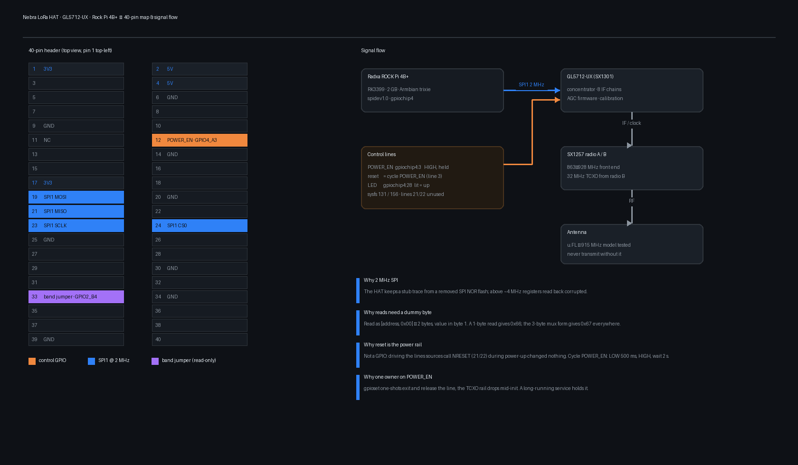

# Hardware, 40-pin wiring and LEDs



## The two boards

```
┌──────────────────────────────┐          ┌─────────────────────────────────┐
│ Radxa ROCK Pi 4B+            │  40-pin  │  Nebra LoRa HAT                 │
│ RK3399 · 2GB · 32GB          │◄────────►│  MAXIIOT GL5712-UX              │
│                              │          │  SX1301 concentrator            │
│  SPI1 (spidev1.0)            │          │  SX1257 radio A + radio B       │
│  GPIO4 bank (gpiochip4)      │          │  u.FL / SMA antenna             │
└──────────────────────────────┘          └─────────────────────────────────┘
```

The HAT is a **915 MHz family** module: US915 / AU915 / KR920 / AS923-1..4. It is
*not* an EU868 board — the module here is the **GL5712-UX**, with a **902–928 MHz**
front end.

## Signals that matter

| Signal | Header pin | GPIO | gpiochip4 line | sysfs number | Direction | Notes |
|---|---|---|---|---|---|---|
| SPI1 MOSI | 19 | GPIO1_A? | — | — | Pi → HAT | |
| SPI1 MISO | 21 | — | — | — | HAT → Pi | |
| SPI1 SCLK | 23 | — | — | — | Pi → HAT | |
| SPI1 CS0 | 24 | — | — | — | Pi → HAT | `/dev/spidev1.0` |
| **POWER_EN** | 12 | GPIO4_A3 | **3** | **131** | Pi → HAT | Hold **HIGH**; enables the TCXO/PA rail. **Cycling it is the reset** |
| RESET (no confirmed pin) | — | GPIO4_C5 / GPIO4_C6 | 21 / 22 | 149 / 150 | Pi → HAT | Candidates only: asserting either during power-up did **not** reset the chip. No header pin could be confirmed |
| **Status LED** | — | GPIO4_D4 | **28** | **156** | Pi → HAT | Green LED = `nebra-hat` service alive (POWER_EN held) |
| Band jumper sense | 33 | GPIO2_B4 | — | **76** | HAT → Pi | Read LOW ⇒ 915 MHz jumper fitted |
| GND | 6, 9, 14, 20, 25, 30, 34, 39 | — | — | — | — | Common ground |

sysfs number = `gpiochip base + line`. On this SoC `gpio4` has base **128**:

```
GPIO4_A3 → 128 + 3  = 131   POWER_EN  (cycling it resets the chip)
GPIO4_C5 → 128 + 21 = 149   reset candidate only — measured to do nothing
GPIO4_C6 → 128 + 22 = 150   reset candidate only — measured to do nothing
GPIO4_D4 → 128 + 28 = 156   LED
GPIO2_B4 →  64 + 12 =  76   band jumper
```

## The three things that confuse everyone

**1. The reset is the power rail, not a GPIO.**
**Measured, not assumed.** With the rail up, we drove `gpiochip4` line 21
(sysfs 149) and line 22 (sysfs 150) HIGH during power-up — the concentrator
answered `0x67` both times, and again after release. Cycling `POWER_EN`
(line 3) is what resets the chip: LOW 500 ms, HIGH, wait 2 s.

Community reports disagree on the reset pin (line 21 vs line 22). Treat both as
unverified on your revision and test before wiring: if asserting the line during
power-up does not hold the chip dead, it is not the reset line.

**2. Register reads need a dummy byte — 2 bytes, not 3.**
The HAL reads with `[address, 0x00]` and takes the value from byte 1. Sending
only `[address]` leaves MISO undriven and returns a constant `0x66`. The 3-byte
mux form `[0x00, addr, 0x00]` (LGW_SPI_MUX_MODE1) is a trap on this carrier: it
returns `0x67` at *every* address — clock bleed that looks like a real answer.

Everything read uniformly `0x66` until the address byte was followed by a dummy
byte. See `scripts/sx_probe.py`.

**3. SPI runs at 2 MHz, not 8–10 MHz.**
This HAT has a stub trace where the SPI NOR flash used to be; above ~4 MHz the
signal integrity is bad enough that registers read back wrong. 2 MHz is stable
across thousands of transfers.

## LEDs — what they actually mean

The HAT has **two** LEDs and they are easy to misread because they sit on the
edge of the board:

- **Orange** — HAT has standby power. The Pi itself may be off.
- **Green** — the Pi is powered and running. Pressing the HAT button moves it
  from orange to green.

The green LED is driven by this project, not by the HAT. The Linux service
`nebra-hat` holds the LED line HIGH for as long as it holds POWER_EN, so
a steady green light means the HAT is powered and the service is alive. If the
service stops, the light goes out — the fastest field diagnostic you have.

> The GL5712-UX module itself has **no LED**. No light on the module is normal.

## Antenna

- Never power the HAT or transmit without an antenna attached.
- The u.FL connector is fragile: push straight down until it clicks, never sideways.
- For a realistic test, put the antenna somewhere with line of sight; indoor
  placement at ground level will hear a handheld node a few rooms away and
  almost nothing else.
